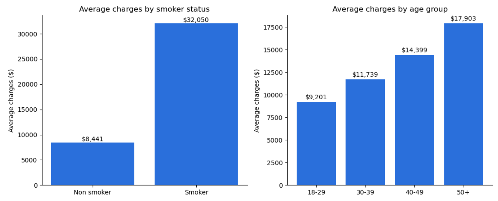
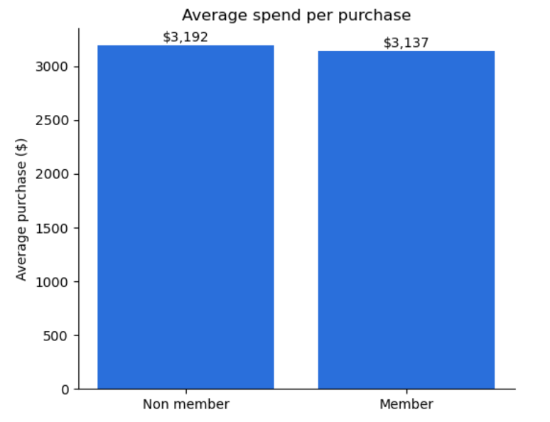

# Healthcare Insurance Cost Drivers and Retail Loyalty Analysis

**Could a retail style rewards program work in health insurance?**

## In short

- Smokers are charged about 3.8 times more than non smokers ($32,050 against $8,441 on average), and charges rise with age.
- In the retail data, loyalty members spend no more than non members ($3,137 against $3,192 per purchase).
- A rewards program should aim at smokers and people aged 50 and over, who cost the most. Nothing in this data proves that points change behavior, so a small pilot should come first.

## 1. The question

Stores give customers points for spending, so that they come back. This project asks whether the same idea could work in health insurance, where points would reward healthy actions such as checkups. To explore it, I used two public datasets: one on insurance costs and one on retail loyalty.

## 2. The data

| Dataset | Rows | What it holds |
|---|---|---|
| insurance.xlsx | 1,338 | Age, sex, BMI, children, smoker status, region and insurance charges for each person |
| Electronic_sales_Sep2023-Sep2024.xlsx | 20,000 | Electronics purchases from 12,136 customers, with loyalty membership, product, price, order status, payment and shipping type |

Data sources: the insurance file is the Medical Cost Personal Datasets on Kaggle (https://www.kaggle.com/mirichoi0218/insurance). The sales file is Customer Purchase Behavior, Electronic Sales Data (Sep 2023 to Sep 2024) by Cameron Seamons, also on Kaggle.

The two datasets describe different people, so I analyzed them separately and connected them only at the level of the business idea. The insurance file holds one charge amount per person, not individual claims.

## 3. How I cleaned it

- **Insurance:** no missing values. I removed 1 duplicate row (1,338 to 1,337).
- **Sales:** no duplicates. One missing gender was labeled Unknown. 4,868 blank add-on entries mean the customer bought no add-on, so I filled them with "None" instead of deleting the rows.
- **A spelling problem:** `PayPal` and `Paypal` appeared as two payment methods (3,284 and 2,514 orders). I merged them into one (5,798). Left alone, one spelling showed a false 35.2% cancellation rate.
- **Other steps:** standardized column names, converted dates, and coded smoker and loyalty status as 0 and 1.
- **Revenue** counts only completed orders (13,432 of 20,000), because a cancelled order brings in no money.

### Excel summaries

I also summarized each workbook with pivot tables and charts. In `insurance.xlsx`: average charges by smoker status and by age. In `Electronic_sales_Sep2023-Sep2024.xlsx`: average spending by loyalty membership and by age. The results agree with the Python numbers below. The one small difference is non smokers: $8,434 in Excel against $8,441 in Python, because the Excel pivot still includes the 1 duplicate row that I removed in Python.

## 4. What I found

### Insurance charges

| Group | Average charges |
|---|---|
| Non smokers | $8,441 |
| Smokers | $32,050 |
| Age 18 to 29 | $9,201 |
| Age 30 to 39 | $11,739 |
| Age 40 to 49 | $14,399 |
| Age 50 and over | $17,903 |
| Normal BMI | $10,409 |
| Obese (BMI 30 and over) | $15,572 |

Region matters little: average charges range from $12,347 (Southwest) to $14,735 (Southeast).

**Linear regression** on age, BMI, children, smoker status and region:
- On a single test split: R squared 0.807, average error (MAE) $4,178, RMSE $5,958.
- With 5 fold cross validation, R squared ranged from 0.674 to 0.807 and averaged **0.739**. I report the average, because one split can flatter a model.
- With the other factors held fixed, smoking adds about $23,067 to the predicted charge, each year of age about $248, each BMI point about $318 and each child about $533.

### Retail loyalty

- **Spending:** members average $3,137 per purchase and non members $3,192. The middle values are the same ($2,528 and $2,534).
- **Cancellations:** 32.8% for members and 32.9% for non members. Every product, payment method and shipping type falls between 30.7% and 33.8%, so no group stands out.
- **Products:** smartphones bring the most completed revenue ($14.4M of $42.6M, about 34%) and headphones the least ($2.7M). Average ratings are about 3.0 for every product, except smartphones at 3.32.
- **Can purchase data identify members?** No. A logistic regression, split by customer so that no customer appears in both training and test data, reached a ROC AUC of 0.477, which is no better than chance. Its accuracy (0.494) was below the baseline of guessing "non member" for everyone (0.778). Predicting membership would need data such as enrollment date, visit frequency and membership tenure.

## 5. Recommendation

A rewards program should target smokers and customers aged 50 and over, who drive the highest charges. The retail data gives no evidence that points change behavior, so I would run a small pilot first and measure the result.

## 6. Limitations

- These are associations in observational data, not proof of cause.
- The two datasets describe different people and cannot be joined.
- In the retail file, 2,270 of 12,136 customers appear as both members and non members. The dataset notes that membership changes over time, so I compared members and non members per purchase, not per customer.
- There was no program data, so the effect of points could not be measured.
- The regression is linear, and its R squared varied from 0.67 to 0.81 across splits.

## 7. Tools and files

- **Python:** Pandas, NumPy, scikit learn and Matplotlib, in `Healthcare_Insurance_Cost_Drivers_and_Retail_Loyalty_Analysis.ipynb`
- **Excel:** the data workbooks `insurance.xlsx` and `Electronic_sales_Sep2023-Sep2024.xlsx`, each with 2 pivot tables and 2 charts. Keep them in the same folder as the notebook to run it.
- **Charts:** `charges_by_smoker_and_age.png` and `spend_by_loyalty.png`
